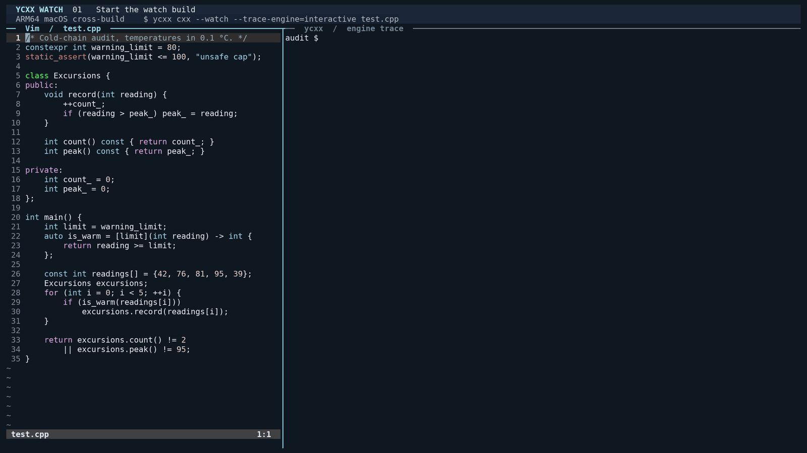

# ycxx

**An independent, resident C++26 compiler.**

ycxx is being built to compile C++26 from source to linked executables by itself: preprocessor,
front end, constant evaluator, code generator, object writer and linker. It is designed not to
run once per translation unit and exit, but to stay resident, hold the whole program's analysis
in memory, and, when a file changes (reported by a file-system watcher, an editor or a build
tool), recompute only what that change can affect.

## Watch mode demo

Vim edits trigger live rebuilds in ycxx's interactive trace. The demo follows one function through
L1 IR, lowered L2 IR, and emitted ARM64 instructions, then shows compiler errors and their fixes.
The final Linux x86-64 self-check uses the freestanding support in [#380](https://github.com/yrashk/ycxx/pull/380).



[View the GIF at full size](docs/media/ycxx-watch-ir-codegen.gif)

## Status

**Pre-0.1** (as of 2026-11-19). ycxx compiles a substantial subset of C++ (C-like code, classes,
templates and constant evaluation) on macOS arm64, from source to a signed, running executable,
with no external compiler, assembler or linker. It also builds static executables from a
freestanding C++ subset for x86-64 Linux. The standard library is out of reach. The plan is in
[DECISIONS.md](DECISIONS.md), the details of the code in [STATUS.md](STATUS.md), and the work in
[GitHub issues](https://github.com/yrashk/ycxx/issues) and the
[roadmap](https://github.com/yrashk/ycxx/issues/12).

### What you can do today

**Compile and run programs on macOS.** `ycxx cxx a.cpp -o a` (also `-c`, `-fsyntax-only`, `-E`, `-I`,
`-D`, `-std=c++26`, and `-fclass-call-abi=apple` to pass classes as Apple Clang does) builds an executable with ycxx's own front end, IR, AArch64 code generator
and Mach-O linker. It also links object files from Clang or GCC. Errors are reported as
`file:line:col: error: …`.

```sh
tools/build
build/bin/ycxx cxx hello.cpp -o hello && ./hello
```

**Compile for x86-64 Linux.** Select `--target=x86_64-pc-linux-gnu` to compile with the scalar
System V AMD64 backend. Use `-c` to write an ELF object, or `-nostdlib` to link C++ sources,
ycxx-generated `.o` files, or a mixture into a static executable. The startup runs namespace-scope
initializers, then calls `int main()` or `int main(int, char**)` and passes its return value to Linux
as the exit status. A program without such initializers can supply its own `_start`. Given
`example.cpp` containing
`int main() { return 0; }`, run the following on x86-64 Linux.

```sh
build/bin/ycxx cxx --target=x86_64-pc-linux-gnu -c example.cpp
build/bin/ycxx cxx --target=x86_64-pc-linux-gnu -nostdlib example.o -o example
./example
```

Linux objects can make direct calls to variadic functions such as `printf` within the scalar
INTEGER ABI subset. Use the host linker to link these objects with libc.
[#399](https://github.com/yrashk/ycxx/issues/399)

**Language on macOS.** Programs can use:
- the fundamental integer, character and floating types, pointers, arrays, references and
  enumerations; `float`, `double` and `long double` with literals, arithmetic, comparisons and
  conversions giving Clang's results bit for bit, and passing and returning them (classes of
  floating members included) by Clang's calling convention;
  all operators, and the statements: `switch`, labels and `goto`, declarations in conditions,
  init-statements in `if` and `switch`, and range-based `for` over arrays or classes with
  `begin` and `end`, with optional init-statements. Functions support default arguments,
  recursion, operator overloading and calls through pointers. A pointer or reference target type
  can select a free or static member overload.
- classes and unions: data and static members, named data members of unnamed union type,
  member functions, constructors and destructors
  with RAII, aggregate and designated initialization, namespace-scope objects initialized by
  code before `main` and destroyed after it, block-scope `static` variables initialized once, passing and returning them by value with
  Clang's calling convention, so ycxx and Clang objects call each other; access control
  (`public`, `protected`, `private`) and friend functions and classes;
- single and multiple inheritance (not virtual): base classes laid out as Clang does, member
  lookup through bases, derived-to-base conversions, base initializers;
- namespaces, nested (`namespace a::b`) and inline ones, typedefs and alias declarations,
  `using` declarations and directives;
- `[[…]]` attributes, the GNU attributes and `asm` labels the macOS SDK's headers use, the
  GNU pointer qualifiers glibc uses, and the type-trait built-ins libycxx's headers use
  (`__is_same`, `__remove_cv`, …)
  ([docs/EXTENSIONS.md](docs/EXTENSIONS.md));
- templates: function, class and variable templates, deduction, partial ordering, explicit and
  partial specializations, static constexpr members of class templates, member function and
  constructor templates, parameter packs and fold expressions, alias templates, template
  template parameters, concepts and requires-expressions in overload resolution,
  `if constexpr`, two-phase lookup, with Itanium names identical to Clang's; Clang's
  `__make_integer_seq`;
- placeholder types: `auto` and `decltype(auto)` variables (`const auto&`, `auto*`, `auto&&`),
  deduced and trailing return types, in templates too;
- lambdas in function bodies: captures by copy and by reference, capture-defaults, `this` and
  `*this`, init-captures, `mutable`, conversion to a pointer to function, generic lambdas (`auto`
  parameters) and template lambdas (`[]<class T>`), and closures passed to and called from
  function templates, with Clang's names for closure types;
- casts, `sizeof`/`alignof` (classes included), `decltype`, and calls through pointers to
  functions;
- constant evaluation on ycxx's own interpreter: `constexpr`, `consteval`, `constinit`,
  `static_assert` and `if consteval`, with errors that explain why something is not constant;
- `extern "C"` functions from libSystem, including `printf` with integers, characters,
  floating values, pointers and strings as arguments, and the SDK `<math.h>`'s built-ins
  (`__builtin_fabs`, `__builtin_inf`, `__builtin_huge_val`, `__builtin_nan`).

**Preprocessing.** All of translation phase 4: includes, object-like and function-like
macros, conditionals, `_Pragma` and the predefined macros. `ycxx cxx -E` matches Clang's output.
`ycxx cxx -E --target=x86_64-linux-gnu` selects Linux macros and glibc's multiarch include path
and preprocesses glibc's `<stdio.h>`. Linux `<stdarg.h>` supplies the `va_list` declaration.

**Incremental builds through a resident daemon.** `ycxx cxx` hands its work to a per-project
`ycxx daemon` (`YCXX_NO_DAEMON=1` runs in-process), which watches the files it has read and keeps
its analysis between commands. A repeated build re-runs nothing, and an edit re-runs only what
it affects, through code generation and the link. The daemon serves concurrent requests on a
thread pool, and its output is byte for byte that of a cold, in-process build.

**See what the engine does.** `ycxx cxx --trace-engine a.cpp` (or `YCXX_TRACE_ENGINE=stream`)
prints every query the build went through as a colored tree on stderr: what ran, what was
reused, verified green or cut off early, how long it took and on which worker, and how much
memory each cell allocated and retains, with sums per subtree, per query kind and per build. A second build
shows everything reused. A compile error is marked red at the cell where it starts, and its
message is shown up to the root. Diagnostic details include the file, line and column where
available. `--trace-engine=interactive` opens a browser of the trace after the compile: a tree
with each function's IR and assembly, a timeline of the pool's workers, and filters.
`--trace-engine=json` writes the whole trace as JSON Lines, for tools and agents.
`ycxx cxx --watch` stays attached and builds again whenever a file the build read changes,
headers included; with `--trace-engine` each rebuild shows what it re-ran, and
`--trace-engine=interactive` keeps the browser open and adds each rebuild live. `ycxx ctl trace
[--interactive]` attaches to the daemon and shows every request it serves, and `ycxx ctl status`
reports its memory, with what each query kind retains.

**Editor support.** `ycxx lsp` is a language server that reports ycxx's errors as you type,
including those in the headers a file includes, and goes to the definition of a name used in a
function body, through the daemon, without unsaved text ever reaching a build. Each file is
checked with the flags of its last build, or else with its line in the project's
`compile_commands.json`.

### Not yet

- The standard library and its headers. On macOS, C headers such as `<stdio.h>` compile without
  warnings and `printf` runs. libycxx's `<cstdio>` still needs pointer-to-member types, and `<cmath>`
  (which `<math.h>` includes) does not compile yet ([#349](https://github.com/yrashk/ycxx/issues/349)).
- Constexpr lambdas (the interpreter has no class objects yet), lambdas outside function bodies,
  structured bindings, virtual functions, virtual base classes, inheriting constructors, and bases
  of class templates.
- Member class and alias templates, conversion function templates, and constraints on class
  templates and their members.
- Exceptions, optimization (`-O`), and the extended floating-point types (`std::float16_t`, …).
- Hosted linking and general-purpose ELF object interoperability for x86-64 Linux.
- Namespace-scope destruction for x86-64 Linux. [#400](https://github.com/yrashk/ycxx/issues/400)

### In progress

- Standard headers, starting with `<cstdio>` ([#133](https://github.com/yrashk/ycxx/issues/133)).
- ι: statements and declarations, the C++98/11 core: default arguments, block-scope statics,
  casts and arrays ([#337](https://github.com/yrashk/ycxx/issues/337)).
- `auto` and lambdas ([#278](https://github.com/yrashk/ycxx/issues/278)): placeholder types,
  lambdas and generic lambdas are done; constexpr lambdas wait on class objects in the
  interpreter ([#262](https://github.com/yrashk/ycxx/issues/262)).

Next come exceptions ([#89](https://github.com/yrashk/ycxx/issues/89)).

## Goals

- **The C++26 working draft as the specification.** Core language ([lex] through [except]),
  preprocessing ([cpp]) and the resolutions of the Core Working Group's issues list.
- **Resident and incremental.** A query-based engine with recorded dependencies, early cutoff
  and futures: an edit costs work proportional to what it changes, not to the size of the
  translation units that include it. Template instantiations, parsed headers and module
  interfaces are shared across translation units.
- **Highly parallel, still deterministic.** Output (objects, diagnostics, their order) is
  bit-identical regardless of thread count or scheduling.
- **The whole loop in one program.** No external assembler, linker or archiver. Targets in order:
  AArch64 Mach-O (macOS), x86-64 ELF (Linux), then AArch64 ELF.
- **Optimization by search, measured against the competition.** Optimized forms are memoized
  and improved while the compiler is idle. The optimizer uses equality saturation, solver-backed
  instruction selection, register allocation and scheduling, and cost models measured on real
  hardware. Every result is verified before use, and builds stay reproducible. A benchmark corpus
  tracks ycxx against Clang and GCC on every commit.
- **Itanium C++ ABI compatible.** Objects link and interoperate with those of Clang and GCC.
- **A drop-in `c++` front.** A thin client accepts the usual command-line interface and forwards
  to the resident compiler, so existing build systems and test suites can drive it. An LSP server
  sits on the same engine.

## Relationship to libycxx

ycxx is written in C++26 against [libycxx](https://github.com/yrashk/libycxx), an independent
C++26 standard library built the same way. libycxx is a git submodule at
[`deps/libycxx`](deps/libycxx). It is also the standard library ycxx ships for the programs it
compiles. Until ycxx can compile itself, it is built with GCC 16 (with reflection and
contracts enabled) and libycxx, and uses as much of C++20–26 as that compiler allows.

## How it is written

ycxx is implemented by AI agents (Claude, directed by the author) from the C++ working draft,
the CWG issues list, WG21 papers, the Itanium C++ ABI, the target architectures' and object
formats' published specifications (Arm and Intel architecture manuals, AAPCS64, the System V
psABI, ELF, Mach-O, DWARF) and cppreference.com. During development the agents have no access to
the sources of other C++ compilers, assemblers or linkers (Clang/LLVM, GCC/binutils, MSVC, EDG,
lld, mold, ld64, Zig's compiler) and do not read their generated code. Compilers are used as
black-box oracles: their outputs and accept/reject behaviour are compared with ycxx's. Their
conformance test suites may be run unmodified as external oracles, and their *test* files read
to triage failures. Nothing from them is copied into this repository.

This is not a clean-room claim in the legal sense. The models the agents run on were trained on
public code that very likely includes those compilers, so no separation from them can be shown,
only that no implementation source was consulted while ycxx was written. A similarity analysis
in the style of libycxx's (`deps/libycxx/docs/similarity/METHOD.md`) is planned. See
[DECISIONS.md §2](DECISIONS.md#2-provenance).

## License

ycxx is licensed under the **Apache License 2.0 with LLVM Exceptions**
(`Apache-2.0 WITH LLVM-exception`). See [LICENSE](LICENSE).
